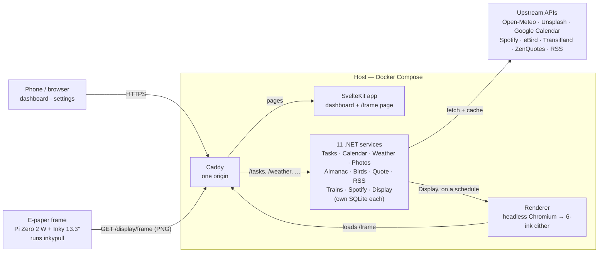

# Hearth

A calm, self-hosted home dashboard designed to look beautiful and recede into the room rather than demand attention. It currently ships as a web dashboard showing art, weather, moon phase, tasks, countdowns, a calendar agenda, Spotify now-playing (and, on the frame, what you last played), news, a daily quote, nearby bird sightings, and nearby transit departures. The long-term target is an always-on e-paper frame — a Pimoroni Inky Impression 13.3" driven by a Raspberry Pi Zero 2 W, fed by a home server running the stack (see [`docs/HARDWARE.md`](docs/HARDWARE.md)).

**Project site:** [hearth.lucas-vertrees.me](https://hearth.lucas-vertrees.me/) — a tour of the frame, the dashboard and how to build one. Its source is in [`site/`](site/).

## How it works

One host runs everything behind Caddy; browsers and the e-paper frame are just clients of it. The frame never renders anything itself — the Display service has the renderer screenshot `/frame` on a schedule and the frame pulls the finished, dithered picture.



See [`docs/SOFTWARE-DESIGN.md`](docs/SOFTWARE-DESIGN.md) for how each piece works.

## Pages

| Route | What it shows |
|-------|---------------|
| `/` | Dashboard — upcoming tasks, countdown events, moon phase, current weather + forecast, now playing, calendar agenda, news feed, daily quote, day arc, nearby bird sightings, almanac facts, nearby transit departures |
| `/calendar` | Month grid with per-day task lists and a detail modal |
| `/ambient` | Fullscreen photo slideshow at a configurable cadence |
| `/settings` | Theme picker, font theme picker, photo cadence and categories, attribution toggle, widget visibility and layout, integrations, subscribed train stops, e-paper frame appearance and layout with live preview |
| `/frame` | E-paper render target (panel-sized, default 1600×1200): Ambient photo, a Daily layout of frame widgets — Today's Arc, Today, Coming Up, Week Ahead, Countdowns, Almanac, Moon Phase, Daily Quote, Birds Nearby, Last Played (the latest Spotify track and its album art) — a pinned Photo or album, one big Countdown, Night (moon and sunrise), or a Note of your own text sized to fill the panel. The mode follows a schedule and manual override set in Settings → Frame |

## Prerequisites

- [Docker](https://docs.docker.com/get-docker/) Engine 25+ (BuildKit) and Docker Compose v2.22+
- [.NET 10 SDK](https://dotnet.microsoft.com/download) *(for running the backend locally without Docker)*
- [Node.js 20+](https://nodejs.org/) *(for running the frontend locally without Docker)*

## Configuration

Services that need secrets use a per-service `.env` file. Create these before starting (Compose expects each to exist, even if empty).

Set the home location and time zone in **Settings → Home** — use the device's location, search for a city, or type coordinates. Weather, Birds, Almanac and the frame preview all read it from the Display service. `LATITUDE`, `LONGITUDE` and `TZ` in the files below still work as fallbacks until one is saved.

**Weather** (`src/Weather/.env`, optional fallback):
```
LATITUDE=40.7128
LONGITUDE=-74.0060
```

**Spotify** (`src/Spotify/.env`):
```
SPOTIFY_CLIENT_ID=...
SPOTIFY_CLIENT_SECRET=...
SPOTIFY_REDIRECT_URI=http://127.0.0.1:8083/spotify/callback
```

**Calendar** (`src/Calendar/.env`):
```
GOOGLE_CLIENT_ID=...
GOOGLE_CLIENT_SECRET=...
GOOGLE_REDIRECT_URI=http://127.0.0.1:8087/calendar/google/callback
```

**Birds** (`src/Birds/.env`; the location is an optional fallback):
```
EBIRD_API_KEY=...
LATITUDE=40.7128
LONGITUDE=-74.0060
```

**Almanac** (`src/Almanac/.env`, all optional; location and zone are fallbacks):
```
LATITUDE=40.7128
LONGITUDE=-74.0060
TZ=America/New_York
FIRST_FROST=10-15
LAST_FROST=04-15
```

**Trains** (`src/Trains/.env`):
```
TRANSITLAND_API_KEY=...
```

Photos, Quote, RSS, and Tasks don't require a `.env` file (Photos needs `UNSPLASH_ACCESS_KEY` only if you want live photo fetching instead of local uploads).

See [`docs/SOFTWARE-DESIGN.md`](docs/SOFTWARE-DESIGN.md) for architecture and endpoint details.

## Running in Docker

### Development (with live reload)

```bash
docker compose watch
```

Compose automatically merges `docker-compose.override.yml` (dev overrides) with `docker-compose.yml`. The frontend runs the Vite dev server — file changes under `frontend/src/` and `frontend/static/` sync into the container and trigger HMR instantly. Changes to `package.json`, `svelte.config.js`, or `vite.config.ts` trigger a container rebuild.

Open [http://localhost](http://localhost).

### Production

```bash
docker compose -f docker-compose.yml up --build
```

Builds the frontend as a static bundle served by Node, and runs all backend services behind Caddy.

## Running Locally (without Docker)

Run each piece in its own terminal:

```bash
# Backend — tasks service
cd src/Tasks
dotnet run
```

```bash
# Backend — weather service (location from Settings → Home via DISPLAY_URL=http://localhost:8090, or LATITUDE/LONGITUDE in src/Weather/.env)
cd src/Weather
dotnet run
```

```bash
# Backend — Spotify service (optional; requires src/Spotify/.env)
cd src/Spotify
dotnet run
```

```bash
# Backend — Photos service (optional; requires src/Photos/.env with UNSPLASH_ACCESS_KEY)
cd src/Photos
dotnet run
```

```bash
# Backend — RSS service
cd src/Rss
dotnet run
```

```bash
# Backend — Calendar service (optional; requires src/Calendar/.env)
cd src/Calendar
dotnet run
```

```bash
# Backend — Quote service
cd src/Quote
dotnet run
```

```bash
# Backend — Birds service (optional; requires src/Birds/.env with EBIRD_API_KEY; location as for Weather)
cd src/Birds
dotnet run
```

```bash
# Backend — Almanac service (optional; src/Almanac/.env with FIRST_FROST, LAST_FROST; location and TZ as for Weather)
cd src/Almanac
dotnet run
```

```bash
# Backend — Trains service (optional; requires src/Trains/.env with TRANSITLAND_API_KEY)
cd src/Trains
dotnet run
```

```bash
# Frontend
cd frontend
npm install   # first time only
npm run dev
```

Vite proxies `/tasks` → `http://localhost:8081`, `/weather` → `http://localhost:8082`, `/spotify` → `http://localhost:8083`, `/photos` → `http://localhost:8084`, `/rss` → `http://localhost:8085`, `/quote` → `http://localhost:8086`, `/calendar` → `http://localhost:8087`, `/birds` → `http://localhost:8088`, `/almanac` → `http://localhost:8089`, `/display` → `http://localhost:8090`, and `/trains` → `http://localhost:8091`, so no CORS configuration is needed. Open [http://localhost:5173](http://localhost:5173).

## Tech Stack

| Layer     | Technology                                              |
|-----------|---------------------------------------------------------|
| Frontend  | SvelteKit 2, Svelte 5 (runes), Tailwind CSS v4, Lucide Svelte |
| Backend   | .NET 10, ASP.NET Core Minimal APIs, SQLite              |
| Proxy     | Caddy 2                                                 |
| Infra     | Docker Compose                                          |

See [`docs/SOFTWARE-DESIGN.md`](docs/SOFTWARE-DESIGN.md) for architecture decisions and [`docs/PRODUCT.md`](docs/PRODUCT.md) for the product vision.
