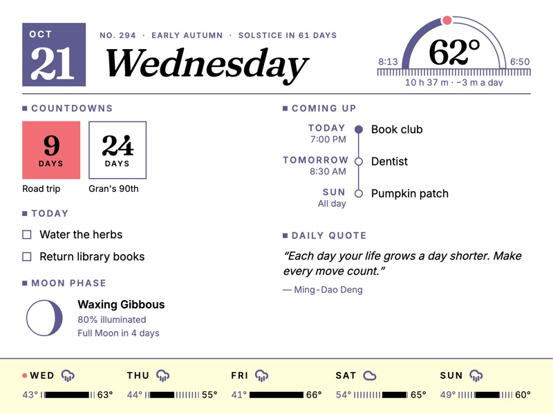
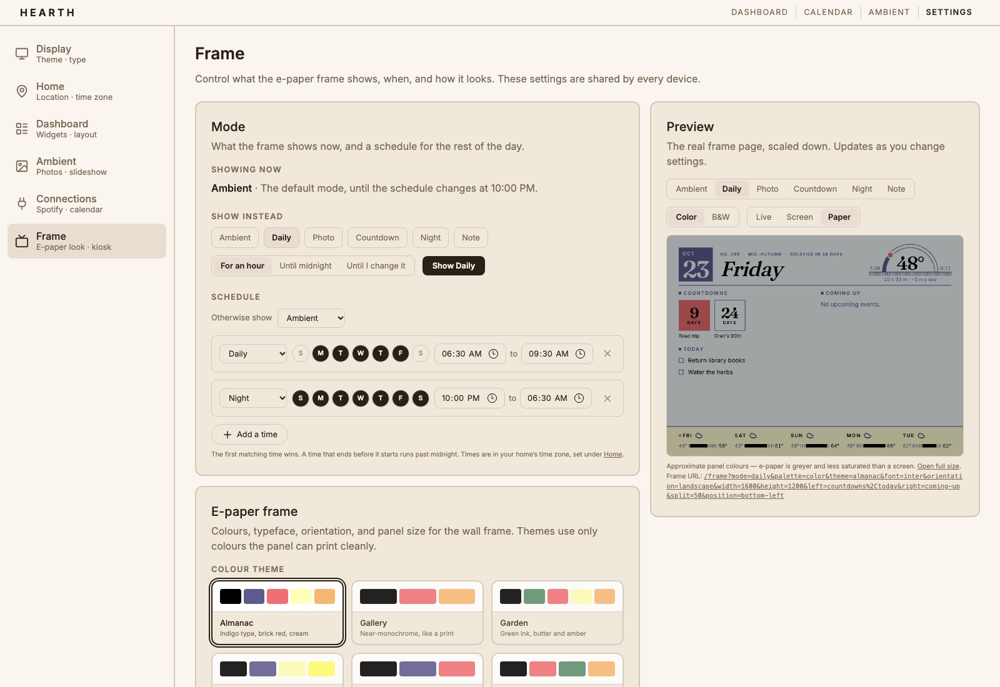
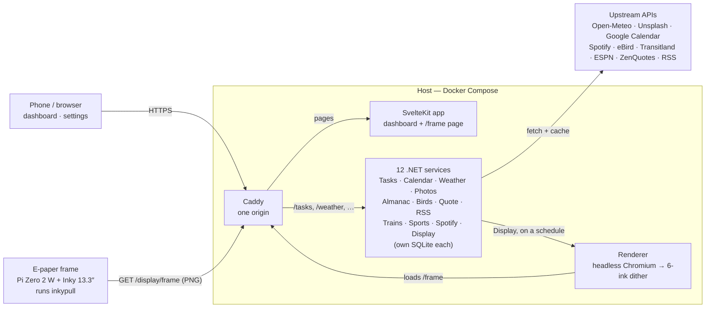

# Hearth

A calm, self-hosted home dashboard for a wall-mounted e-paper frame and any browser in the house.

<table>
  <tr>
    <td width="50%"><a href="site/assets/img/frame-almanac.jpg"></a></td>
    <td width="50%"><a href="site/assets/img/settings-frame.jpg"></a></td>
  </tr>
  <tr>
    <td align="center"><sub>The frame — Daily layout, Almanac theme</sub></td>
    <td align="center"><sub>Settings → Frame, with a live panel preview</sub></td>
  </tr>
</table>

**Project site:** [hearth.lucas-vertrees.me](https://hearth.lucas-vertrees.me/) — a tour of the frame, the dashboard and how to build one (source in [`site/`](site/)).

## What it shows

- **Dashboard widgets:** Agenda (tasks and calendar events), Weather, Countdowns, Moon Phase, Today's News (RSS), Daily Quote, Today's Arc, Birds Nearby, Almanac, Trains & Buses, Sports, plus Now Playing from Spotify.
- **Frame modes:** Ambient, Daily (Today's Arc, Today, Coming Up, Week Ahead, Countdowns, Almanac, Moon Phase, Daily Quote, Birds Nearby, Last Played, Last Result & Next Game), Photo, Countdown, Night and Note, on a schedule you set in Settings → Frame.
- **Pages:** `/` dashboard, `/calendar` month grid, `/ambient` photo slideshow, `/settings`, `/frame` e-paper render target, and an optional `/logs` (Dozzle).

## How it works

One host runs everything behind Caddy. The Display service has the renderer screenshot `/frame` on a schedule, and the frame pulls the finished, dithered picture.



## Quick start

You need [Docker](https://docs.docker.com/get-docker/) Engine 25+ and Compose v2.22+. Compose expects each service's `.env` file to exist, even if it's empty:

```bash
touch src/{Almanac,Birds,Calendar,Photos,Spotify,Trains,Weather}/.env
```

```bash
docker compose up --build
```

Open [http://localhost](http://localhost) and set the home location and time zone in **Settings → Home**. Tasks, quotes and news work with no keys.

## Configuration

Add keys only for the integrations you want. Each file is read by one service:

| Integration | File | Keys | Get a key |
|---|---|---|---|
| Unsplash photos | `src/Photos/.env` | `UNSPLASH_ACCESS_KEY` | [Unsplash developers](https://unsplash.com/developers) |
| Spotify | `src/Spotify/.env` | `SPOTIFY_CLIENT_ID`, `SPOTIFY_CLIENT_SECRET`, `SPOTIFY_REDIRECT_URI` | [Spotify dashboard](https://developer.spotify.com/dashboard) |
| Google Calendar | `src/Calendar/.env` | `GOOGLE_CLIENT_ID`, `GOOGLE_CLIENT_SECRET`, `GOOGLE_REDIRECT_URI` | [Google Cloud console](https://console.cloud.google.com/apis/credentials) |
| eBird | `src/Birds/.env` | `EBIRD_API_KEY` | [eBird API key](https://ebird.org/api/keygen) |
| Transitland | `src/Trains/.env` | `TRANSITLAND_API_KEY` | [Transitland](https://www.transit.land/documentation) |
| Frost dates (optional) | `src/Almanac/.env` | `FIRST_FROST`, `LAST_FROST` (`MM-DD`) | — |

`LATITUDE`, `LONGITUDE` and `TZ` in these files are only fallbacks until a home location is saved in Settings → Home. Every variable, including the redirect URIs to register, is listed per service in [`docs/SOFTWARE-DESIGN.md`](docs/SOFTWARE-DESIGN.md): [Photos](docs/SOFTWARE-DESIGN.md#photos-service), [Spotify](docs/SOFTWARE-DESIGN.md#spotify-service), [Calendar](docs/SOFTWARE-DESIGN.md#calendar-service), [Birds](docs/SOFTWARE-DESIGN.md#birds-service), [Trains](docs/SOFTWARE-DESIGN.md#trains-service), [Almanac](docs/SOFTWARE-DESIGN.md#almanac-service), [Weather](docs/SOFTWARE-DESIGN.md#weather-service).

## Development

`docker compose watch` runs the stack with hot reload. To run pieces natively instead (needs the [.NET 10 SDK](https://dotnet.microsoft.com/download) and [Node.js 20+](https://nodejs.org/)), start any service with `dotnet run --project src/<Service>` and the frontend with `cd frontend && npm run dev`. The ports Vite proxies to are in [`frontend/vite.config.ts`](frontend/vite.config.ts).

Before a PR, run `dotnet build Hearth.slnx && dotnet test Hearth.slnx`, and `npm run check && npm run test` in `frontend/`. More in [Development workflow](docs/SOFTWARE-DESIGN.md#development-workflow).

## Deploying

CI publishes amd64 and arm64 images to GHCR on every green push to `main`. A host pulls them with [`deploy/update.sh`](deploy/update.sh), run by a systemd timer. See [Deploying to a host](docs/SOFTWARE-DESIGN.md#deploying-to-a-host).

To build the frame itself, see [`docs/HARDWARE.md`](docs/HARDWARE.md) and the companion client [inky-pull](https://github.com/lrv1668-gif/inky-pull).

## Docs

- [`docs/PRODUCT.md`](docs/PRODUCT.md) — what Hearth is for and what's planned
- [`docs/SOFTWARE-DESIGN.md`](docs/SOFTWARE-DESIGN.md) — architecture, services, endpoints and environment variables
- [`docs/HARDWARE.md`](docs/HARDWARE.md) — the e-paper frame build

## Credits

Hearth is built on these open-source projects and data providers:

- **Frontend:** [SvelteKit](https://svelte.dev/docs/kit) and [Svelte](https://svelte.dev) (MIT), [Vite](https://vite.dev) (MIT), [Tailwind CSS](https://tailwindcss.com) (MIT), [Lucide](https://lucide.dev) via `@lucide/svelte` (ISC), [DOMPurify](https://github.com/cure53/DOMPurify) (MPL-2.0 or Apache-2.0), [svelte-dnd-action](https://github.com/isaacHagoel/svelte-dnd-action) (MIT), [Vitest](https://vitest.dev) (MIT), [Prettier](https://prettier.io) (MIT)
- **Fonts:** [Fontsource](https://fontsource.org) builds of Inter, Fraunces, Lora, Manrope, Nunito, Source Serif 4 and Space Grotesk (SIL OFL 1.1), and Roboto Slab (Apache-2.0)
- **Backend:** [.NET and ASP.NET Core](https://dotnet.microsoft.com) (MIT), SQLite via [Microsoft.Data.Sqlite](https://github.com/dotnet/efcore) (MIT) and [SQLitePCLRaw](https://github.com/ericsink/SQLitePCL.raw) (Apache-2.0), [FusionCache](https://github.com/ZiggyCreatures/FusionCache) (MIT), [SkiaSharp](https://github.com/mono/SkiaSharp) (MIT), [SpotifyAPI-NET](https://github.com/JohnnyCrazy/SpotifyAPI-NET) (MIT), [Google APIs .NET client](https://github.com/googleapis/google-api-dotnet-client) (Apache-2.0), [DotNetEnv](https://github.com/tonerdo/dotnet-env) (MIT), [xUnit](https://xunit.net) (Apache-2.0)
- **Renderer:** [Playwright](https://playwright.dev) (Apache-2.0) with Chromium (BSD-3-Clause), [epdoptimize](https://github.com/paperlesspaper/epdoptimize) (Apache-2.0), [node-canvas](https://github.com/Automattic/node-canvas) (MIT)
- **Infra:** [Caddy](https://caddyserver.com) (Apache-2.0), [Docker Compose](https://github.com/docker/compose) (Apache-2.0), [Dozzle](https://dozzle.dev) (MIT)
- **Hardware:** Pimoroni [inky](https://github.com/pimoroni/inky) (MIT)
- **Data:** weather from [Open-Meteo](https://open-meteo.com) (CC BY 4.0), photos from [Unsplash](https://unsplash.com), quotes from [ZenQuotes](https://zenquotes.io), sightings from [eBird](https://ebird.org) (Cornell Lab of Ornithology), departures from [Transitland](https://www.transit.land), scores and fixtures from ESPN's public site API, plus [Google Calendar](https://developers.google.com/calendar) and [Spotify](https://developer.spotify.com)

## License

AGPL-3.0 — see [LICENSE](LICENSE).
